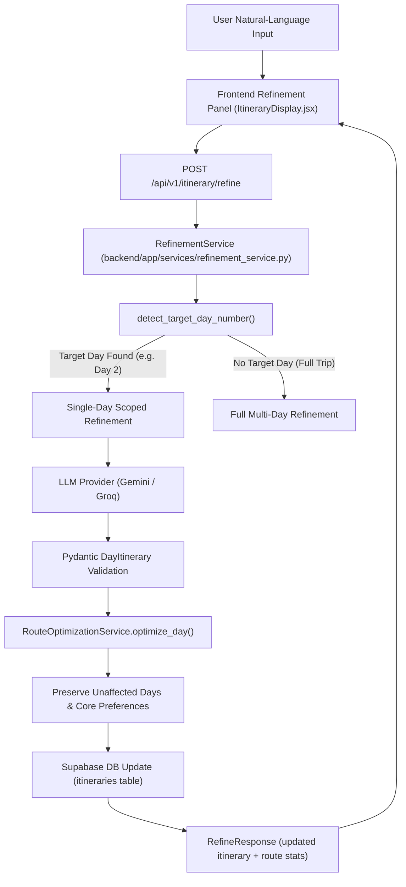

# Activity 4.3: Vibe-Based Personalization & Conversational Itinerary Refinement

## Project Overview
* **Application**: Personalized Travel Itinerary Planner
* **Location**: `D:\genai\personalized-travel-planner`
* **Tech Stack**: React (Vite) + FastAPI + Supabase PostgreSQL + Google Gemini API / Groq API + Framer Motion + Lucide React + Pydantic v2

---

## 1. Vibe Selection System

The planner supports 10 distinct travel vibes, allowing travelers to select **1 Primary Vibe** (which sets overall pacing, tone, and activity priorities) and optional **Secondary Vibes** (which blend in complementary experiences).

### The 10 Supported Vibes

| # | Vibe Name | Lucide Icon | Suggested Pace | Theme & Experience Focus |
|---|---|---|---|---|
| 1 | **Romantic** | `Heart` | Slow | Intimate settings, sunset viewpoints, cozy bistros, relaxed evening walks. |
| 2 | **Adventure** | `Mountain` | Fast | Adrenaline rushes, hiking trails, outdoor thrills, high-energy activities. |
| 3 | **Luxury** | `Gem` | Moderate | High-end dining, private tours, premier comfort, exclusive cultural spots. |
| 4 | **Relaxed** | `Coffee` | Slow | Unhurried mornings, peaceful parks, scenic cafes, gentle strolls. |
| 5 | **Budget** | `PiggyBank` | Moderate | Free walking sights, vibrant markets, street food, cost-effective transit. |
| 6 | **Cultural** | `Landmark` | Moderate | Historic landmarks, world-class museums, local heritage & architectural icons. |
| 7 | **Family** | `Users` | Moderate | Kid-friendly attractions, interactive parks, safe dining, balanced pacing. |
| 8 | **Nightlife** | `Wine` | Fast | Late starts, buzzing districts, rooftop lounges, live music & night spots. |
| 9 | **Nature & Exploration** | `Trees` | Moderate | National parks, botanical gardens, wildlife viewing, scenic viewpoints. |
| 10 | **Food & Culinary** | `UtensilsCrossed` | Slow | Authentic local eateries, food markets, tasting tours, culinary delights. |

---

## 2. AI Prompt Engineering & Vibe Integration

In `backend/app/services/prompt_service.py`, vibe directives are integrated into Section 5 (`Travel Style and Interests`):

* **Primary Vibe Directives**: Specifies the core atmosphere, scheduling rhythm, and tone for the itinerary.
* **Secondary Vibe Directives**: Instructs the LLM to weave in matching attractions or dining options without overpowering the primary vibe.
* **Test Compatibility**: Preserves all 10 numbered sections expected by validation fixtures.

---

## 3. Conversational Itinerary Refinement Architecture

The refinement engine enables natural-language requests such as:
* *"Make Day 2 more adventurous with hiking and rafting"*
* *"Add a rooftop cocktail lounge to Day 1"*
* *"Make the entire trip more relaxing with slower morning starts"*
* *"Reduce dining and transit costs across Day 3"*

### Workflow & Data Flow

### Context & Constraint Preservation
1. **Target Day Isolation**: When modifying Day $N$, Days $1 \dots N-1$ and $N+1 \dots M$ remain completely unmodified.
2. **Preference Lock**: Destination, start/end dates, total budget, dietary restrictions, and travelers count are strictly locked.
3. **Route & Time Optimization**: Automatically re-calculates road distances, travel times, circuity factors, and conflict-free schedules (`morning_activity`, `lunch`, `afternoon_activity`, `dinner`, `evening_activity`) for affected days.
4. **Supabase Persistence**: Safely updates the JSONB representation for the modified day without duplicating rows.

---

## 4. API Endpoints

### 1. `POST /api/v1/itinerary/refine`
Processes full or single-day refinement requests.
* **Request Body**: `ItineraryRefineRequest`
  * `trip_id`: UUID string (optional)
  * `instruction`: Natural-language instruction (e.g. *"Make Day 2 more adventurous"*)
  * `itinerary`: Current `ItineraryResponse` object
  * `target_day_number`: Optional integer (auto-detected if omitted)
  * `provider`: Optional LLM provider (`"gemini"` or `"groq"`)
* **Response**: `RefineResponse`
  * `success`: `true`
  * `message`: Concierge summary of modifications
  * `modified_day_number`: Target day number if single-day refinement
  * `itinerary`: Complete updated `ItineraryResponse`
  * `route_optimized`: `true`
  * `provider_used`: Provider name

### 2. `POST /api/v1/itinerary/refine-day`
Explicitly refines a single `DayItinerary` object with re-optimized route scheduling.

---

## 5. Frontend UI Features

1. **`CreateTrip.jsx`**:
   * Step 3: Visual Vibe Cards grid featuring Lucide icons, short descriptions, suggested pace badges, and "Set Primary" / "+ Secondary" toggles.
   * Step 4: Review section displaying selected Primary Vibe and Secondary Vibes.
   * Integration: Auto-saves drafts and forwards `primary_vibe` and `secondary_vibes` to the trip and itinerary endpoints.
2. **`ItineraryDisplay.jsx`**:
   * Trip Overview Card displays vibrant badges for `Primary Vibe` and `Secondary Vibes`.
   * Conversational Refinement Panel:
     * Interactive chat history with timestamps and user/concierge bubbles.
     * Quick action suggestion chips (e.g. *"Make Day 2 Adventurous"*, *"Make Entire Trip Relaxed"*).
     * Single-click jump to modified day (`[👉 Jump to Day N]`).
     * Route re-optimized indicator pill.
     * Live loading spinners during AI regeneration.

---

## 6. Verification & Test Suite

* **Backend Unit & Integration Tests**: `tests/test_vibe_and_refinement.py` (9 tests)
* **Total Backend Tests**: **99 passed in 1.08s**
* **Frontend Vite Production Build**: **`✓ built in 3.07s`** with zero compilation errors.

